# avatar-pixel

A [Hermes Agent](https://github.com/NousResearch/hermes-agent) plugin that gives every agent (profile) a pixel art avatar, all drawn in the same style.

- **Hermes Desktop:** *Edit profile → Generate* (also when creating a bot) returns a transparent pixel art sprite instead of the generic robot face.
- **Agents:** the `agent_avatar` tool lets an agent draw the avatar of any profile, show it to you, and install it once you approve.
- **Everything else is untouched:** any other image request passes straight through to the delegate backend (`openai-codex` by default), so `image_generate` keeps working as before.

## Two modes

- **icon** (default): a single object that stands for the agent's job, like an app icon.
- **robot**: a small robot character personifying the agent, holding the tools of its job.

Both come from the agent's name and description only (`examples/examples.json`); the icon column is exactly what the Generate button returns with an empty box.

| Agent | Icon | Robot |
|---|:-:|:-:|
| **Finance Bot**<br>Tracks my bills, budget and investments |  |  |
| **My Health Bot**<br>Keeps my exams, medicines and doctor appointments organized |  | 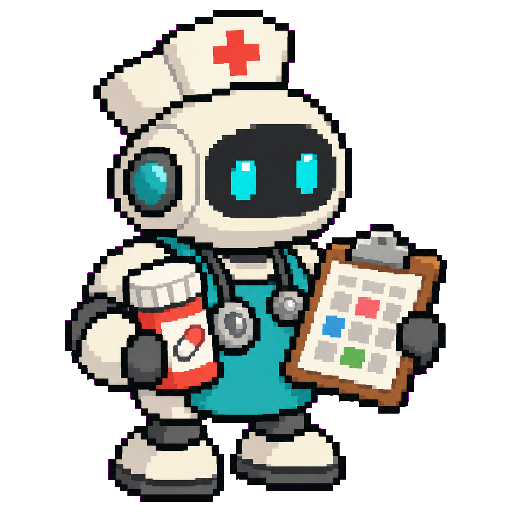 |
| **Developer Bot**<br>Writes code, reviews pull requests and fixes bugs |  |  |
| **Shopping Assistant**<br>Compares prices and tracks my online orders | 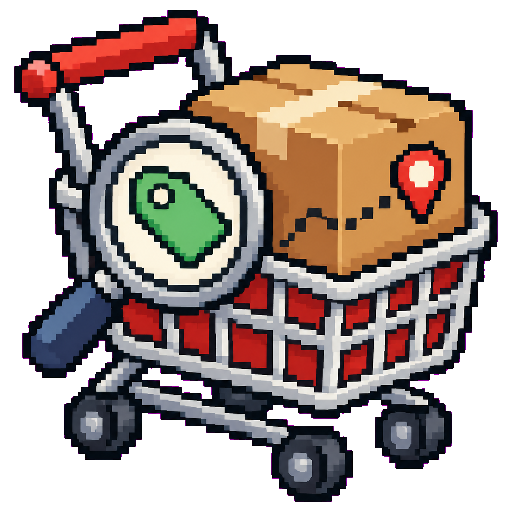 |  |
| **Travel Planner**<br>Plans trips, flights and hotel bookings |  |  |
| **Meal Prep Chef**<br>Plans weekly meals and the grocery list | 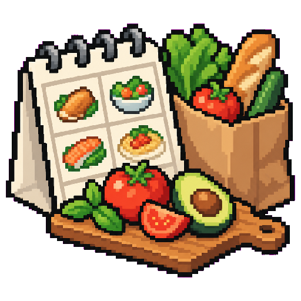 |  |
| **Car Care Bot**<br>Reminds me of oil changes, tires and car maintenance | 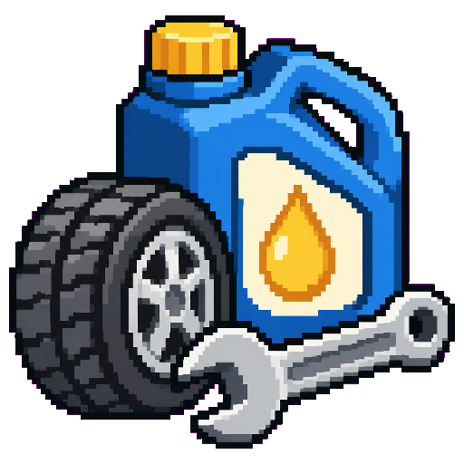 |  |
| **Smart Home Bot**<br>Controls the lights, thermostat and home devices |  | 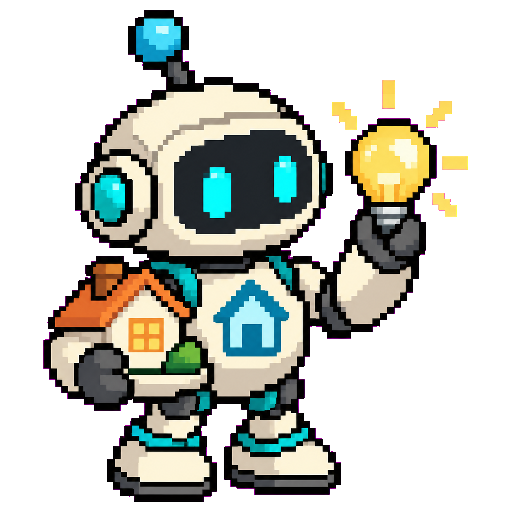 |
| **Fitness Coach**<br>Builds my workouts and tracks my training | 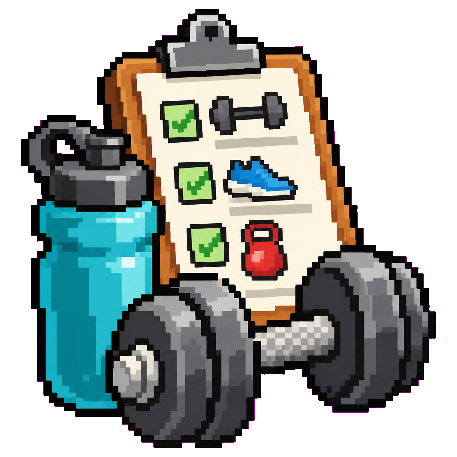 |  |
| **Study Buddy**<br>Helps me study with flashcards and summaries |  |  |
| **Inbox Triage**<br>Sorts my email and drafts replies |  |  |
| **Plant Care Bot**<br>Reminds me to water and fertilize my plants | 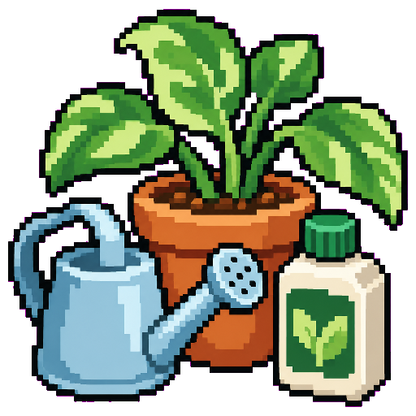 | 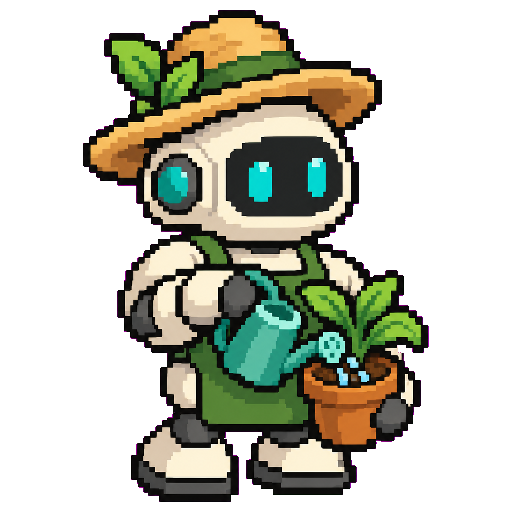 |
| **Pet Care Bot**<br>Tracks my dog's vaccines, food and vet visits | 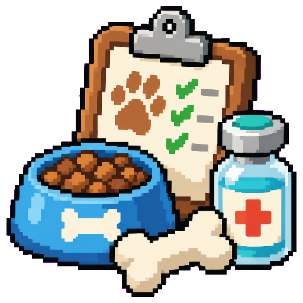 | 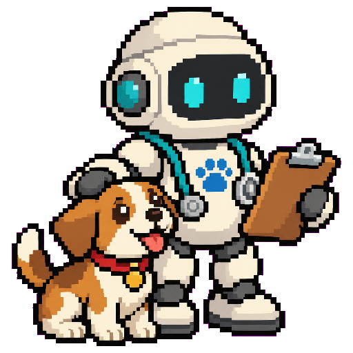 |
| **Security Watch**<br>Monitors servers and alerts me about incidents |  | 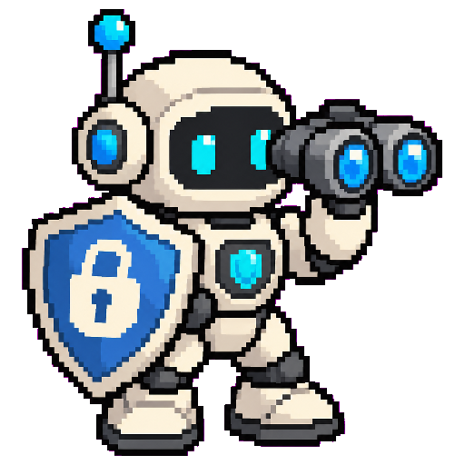 |
| **Music DJ**<br>Builds playlists for every mood |  |  |
| **Calendar Assistant**<br>Schedules meetings and protects my focus time |  |  |

## How it works

1. The style lives in `assets/style/` (three approved sprites sent as reference images) and in `STYLE_PROMPT` (`pixel.py`): chunky pixels, dark 1-pixel outline, flat colors, chibi proportions, no text.
2. The model draws on a flat magenta background; the plugin keys it out (falling back to a flood fill when the model returns white), crops to the sprite and scales it with nearest neighbour to fill a 512×512 square.
3. The result is a transparent PNG, so it looks right in light and dark themes.

## Install

```bash
git clone https://github.com/BrOrlandi/hermes-avatar-pixel-plugin ~/.hermes/plugins/avatar-pixel
hermes plugins enable avatar-pixel
hermes config set image_gen.provider avatar-pixel        # in every profile that should use it
hermes gateway restart
```

Requires an image backend that accepts reference images (`openai-codex` with gpt-image-2 works without an API key: `hermes auth add openai-codex`). Pick another with `AVATAR_PIXEL_DELEGATE`. Set the default mode with `AVATAR_PIXEL_MODE=icon|robot`.

Hermes Desktop reads the image backend of the profile it is talking to, so set `image_gen.provider` in each profile (or the Generate tab says "No image model available").

## Using it

**Generate tab** (Edit profile or Create bot):

| You type | What is drawn |
|---|---|
| nothing | the bot's catalog entry, or an icon picked from its name and description |
| `a red sports car` | exactly that (`robot a pilot` / `icon a red car` force a mode) |
| `Finance Bot: a piggy bank with glasses` or `<profile-id>: ...` | that bot (catalog entry, description) with your text as extra direction |
| `Finance Bot: robot` or `Finance Bot: icon, gold coins` | that bot in the chosen mode |

**Agents:** ask your main agent something like *"make a new avatar for the finance profile, with a piggy bank"*. It calls `agent_avatar(profile="finance", details="a piggy bank")` (add `mode="robot"` or `mode="icon"` to choose), sends you the picture, and calls it again with `image=<path>, apply=true` after you approve. The `avatar_pixel` toolset must be enabled for that agent (`hermes tools`).

## Catalog (optional)

Fix the subject, reference images or a hand-made avatar per profile in `<hermes root>/avatar-pixel/catalog.json` (or `AVATAR_PIXEL_CATALOG`). Paths are relative to the catalog file.

```json
{
  "finance": {"name": "Finance Bot", "subject": "a gold coin with a dollar sign next to a rising green chart"},
  "coffee":  {"name": "Coffee Shop", "subject": "the cat mascot from the reference photo", "references": ["refs/cat.png"]},
  "default": {"name": "Main", "image": "fixed/main.png"}
}
```

| Field | Meaning |
|---|---|
| `name` | Matches the bot title the Desktop sends |
| `subject` | What to draw, in English (one concrete sentence) |
| `references` | Extra reference images showing what the subject looks like (logos, mascots) |
| `image` | Hand-made transparent avatar returned as is |
| `holes` | `[x, y]` seeds for the white-background fallback, for enclosed gaps |

## Development

```bash
python -m pytest tests                                          # pure helpers, needs Pillow
/opt/hermes/.venv/bin/python examples/generate_examples.py      # regenerate the gallery (inside Hermes)
```

## License

MIT
